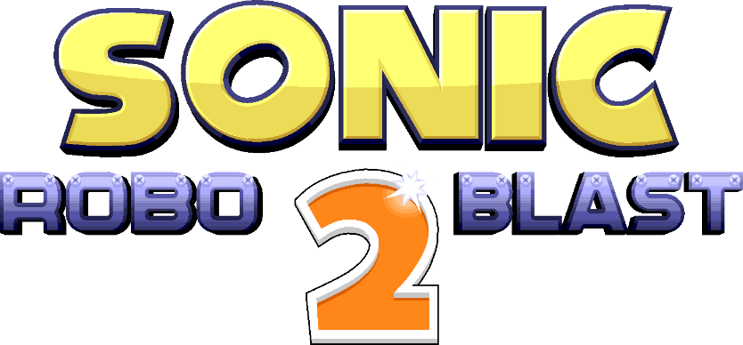

# Sonic Robo Blast 2 Web (SRB2web)

_**Web Version: 2.2.15**_

[Sonic Robo Blast 2](https://srb2.org/) is a 3D Sonic the Hedgehog fangame based on a modified version of [Doom Legacy](http://doomlegacy.sourceforge.net/).

A port of the game for WASM (WebAssembly) using Emscripten, fully supporting LAN & online multiplayer through its [Relay Server](https://github.com/gvbvdxxalt2/SRB2Web-Relay).

Also check out my other web ports: [SRB2Kart Web](https://github.com/gvbvdxxalt2/SRB2KartWeb), [SRB2Legacy Web](https://github.com/gvbvdxxalt2/SRB2LegacyWeb)

> **Working-copy note:** This folder is a space-saving web build snapshot extracted from the upstream archive. It includes the launcher, static assets, and prebuilt WebAssembly files, but not Git history or the complete native SRB2 source tree. The upstream repository remains the source for those files.

> **AI usage is in this port:**
> This port is written with the help of AI, mostly the C side code and compiling commands, and small help with emscripten calls and API references.
> Though the JavaScript side, (the launcher page, file manager) is stylized and written by me, some bug fixes are also written by AI.
> The AI I used is mostly Google Gemini, alongside Github Copilot (in vs code), please do not let this discourage you from playing or using this port, as the C code is still written by real human developers from SRB2.

> [!IMPORTANT]
> This port may be updated in a way that makes older versions break compatibility with the relay servers,
> in that case, you should make sure you always merge your source code (and use forks instead of directly downloading and reuploading the source) when possible!

---

## Live Sites

 - [Gvbvdxx.me (My own domain)](https://srb2web.gvbvdxx.me)
 - [Vercel (May not be up)](https://gvbvdxx-srb2-web.vercel.app/)
 - [Netlify (May not be up)](https://gvbvdxx-srb2web.netlify.app/)

---

## Compilation Instructions

Below are the instructions for compiling the Sonic Robo Blast 2 (SRB2) WASM files and building the launcher website.

### Prerequisites
* **Windows**: Git for Windows, CMake, Python 3.x, and a C++ toolchain (Visual Studio).
* **Linux**: `sudo apt install git cmake build-essential python3`
* **Node.js**: Required for the launcher website.

---

### 1. Compiling the WASM Files

#### Executing on Windows

> **Note:** Windows hasn't been tested yet. If it is having issues, try using [Github codespaces](https://github.com/codespaces) or WSL to compile.

1. Open the **Command Prompt** (`cmd.exe`).
2. Navigate to your source directory:
   ```cmd
   cd path\to\srb2-source
   ```
3. Run the setup and build script:
   ```cmd
   setup-build.bat
   ```

#### Executing on Linux
1. Open your terminal.
2. Navigate to your source directory:
   ```bash
   cd path/to/srb2-source
   ```
3. Run the setup script (this handles cloning and builds the engine):
   ```bash
   chmod +x *.sh
   source ./setup-build.sh
   ```

4. To rebuild later without running the full setup:
   ```bash
   source ./load-emsdk.sh
   ./build-wasm.sh
   ```

---

### 2. Building the Launcher Website

This should work on both Windows and Linux.

1. Install Node.js dependencies:
   ```bash
   npm install
   ```
2. Build the launcher:
   ```bash
   npm run build
   ```
3. Start the dev server:
   ```bash
   npm run start
   ```

> **Note for Developers:** If you modify the **C source code**, you must re-run `setup-build.sh` (or `build-wasm.sh`) to recompile the engine. The Node server only watches frontend files.

---

## Importing Your Add-ons, Models, and Saves

Keep add-ons and models out of the GitHub Pages build. GitHub Pages has a 1 GB published-site limit, and browser storage can also run out if every file is installed at once. The save and replay files in `web-assets/default-saves` are bundled with the public site and copied directly into `/addons/userdata` only when a matching file is not already present. Do not put private saves there. Other personal files can be stored in a separate public Cloudflare R2 bucket and imported selectively.

1. Create an R2 bucket and enable its public `r2.dev` URL. The manifest and assets are publicly readable; only upload content you have permission to share.
2. In the bucket's CORS settings, allow `GET` from the exact origin serving this site (and `http://localhost:3000` while developing). Allow the `GET` method and `*` request headers.
3. On your home computer, sign in to Wrangler once:
   ```powershell
   npx wrangler login
   ```
4. Preview what will be uploaded, then run the uploader. Replace the bucket name and public URL with the values from Cloudflare:
   ```powershell
   node .\scripts\upload-custom-assets.js --root "C:\Users\ethan\Downloads\srb2" --preview
   node .\scripts\upload-custom-assets.js --root "C:\Users\ethan\Downloads\srb2" --bucket "your-bucket" --public-base-url "https://your-public-bucket-url.r2.dev"
   ```
   The script uploads files from `addons`, `models`, `models.dat`, and recognized save/replay files. It does not upload the base game files. Uploading is an explicit step; nothing is sent by building or running the site.
5. Open the site's File Manager, choose **Import my cloud files**, paste the URL ending in `/srb2-custom/manifest.json`, and choose add-ons, models, saves, or all files. The browser stores imported files in its own local storage. Add-ons go into the user's `.srb2/addons` folder; models and `models.dat` are linked into the game's model paths.

Choose only what the browser has room for. The imported data is specific to that browser profile and does not automatically transfer to another computer. The importer provides the files; actual 3D rendering still depends on WebGL support and the browser build's hardware renderer.

---

## Publishing the Website

The included `.github/workflows/build_site.yml` builds the site and publishes its output to a `deploy` branch whenever code is pushed to `main`.

1. Put this project in a GitHub repository or fork the upstream project.
2. Push changes to the repository's `main` branch.
3. In the GitHub repository, open **Settings → Pages** and select **Deploy from a branch**, then choose the `deploy` branch and `/ (root)`.
4. After the Actions run succeeds, open the Pages URL. Open its File Manager, choose **Import my cloud files**, and paste the R2 manifest URL.

Do not commit your personal add-ons, model files, or saves to GitHub. They stay in R2 and are fetched only when selected in the browser. The school network must allow both the Pages site and the R2 public URL; this setup does not bypass network restrictions.

---

## Directory Structure

| Path | Description |
| :--- | :--- |
| [`/src`](./src) | Core C code for **SRB2** and the modified engine. |
| [`/web-game-assets`](./web-game-assets) | Source files for game data (textures, sounds, etc.). |
| [`/src/web-src`](./src/web-src) | Source code for the web launcher and file manager. |
| [`/src/web-static`](./static) | Static assets, icons, and images for the launcher. |
| `/web-build` | The production-ready web build (generated via `npm run build`). |
| [`/web-emscripten-wasm/bin`](./web-emscripten-wasm/bin) | Where the web port's compiled emscripten output is (js and wasm files) |
